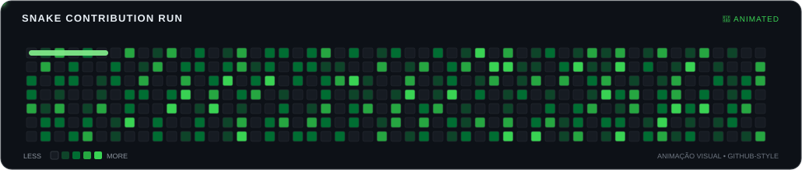

# Olá, eu sou Diego Faria! 👋

<h3 align="center">
  Desenvolvedor Full Stack | Flutter & Firebase | Python, IA & Dados
</h3>

  

---

## 👨‍💻 Sobre mim

Sou desenvolvedor Full Stack apaixonado por tecnologia, inovação e resolução de problemas.

Tenho interesse no desenvolvimento de aplicações mobile, arquiteturas escaláveis, sistemas inteligentes e soluções baseadas em Inteligência Artificial.

Gosto de explorar novas tecnologias, estudar algoritmos e transformar conceitos complexos em aplicações práticas.

- 📱 Desenvolvimento mobile com Flutter e Dart.
- ☁️ Backend e infraestrutura com Firebase e AWS.
- 🧠 Inteligência Artificial e Machine Learning com Python.
- 📊 Análise de dados, automação e otimização.
- 🚀 Arquitetura de software e sistemas escaláveis.

---

## 🛠️ Tecnologias e ferramentas

### 📱 Mobile Development

### ☁️ Backend & Cloud

### 💻 Linguagens de programação

---

## 🧠 Áreas de interesse

- Inteligência Artificial e Machine Learning.
- RAG (Retrieval-Augmented Generation) e agentes de IA.
- Visão Computacional.
- Metaheurísticas e otimização.
- Sistemas concorrentes e paralelos.
- Automação inteligente e análise de dados.

---

## 📚 Atualmente aprendendo

- Clean Architecture e Riverpod no Flutter.
- DevOps e CI/CD.
- Escalabilidade e boas práticas com Firebase.
- Inteligência Artificial aplicada ao desenvolvimento de software.

---

## 📊 Estatísticas do GitHub

  
  

  

---

## 🐍 Cobrinha no estilo do gráfico de contribuições

  

  Animação incorporada ao README: aparece diretamente no perfil, sem precisar abrir outra página. Por enquanto, o quadro é ilustrativo e não representa a contagem real de commits.

---

## 📫 Vamos nos conectar?

  
  
  

  <i>"A tecnologia transforma ideias em possibilidades."</i>

